# Informe de Laboratorio 5.2 - Pipeline de despliegue continuo con Docker

---

# Portada

UNIVERSIDAD MAYOR, REAL Y PONTIFICIA DE SAN FRANCISCO XAVIER DE CHUQUISACA

FACULTAD DE CIENCIAS Y TECNOLOGIA

**Nombre:** VALDA PLAZA CAMILA MONSERRAT

**Carrera:** INGENIERIA DE SISTEMAS

**Asignatura:** Trabajando en la Nube (COM610)

**Docente:** Ing. Marcelo Quispe Ortega

**Semestre:** 2/2026

SUCRE - BOLIVIA

---

## Entregables de la practica

- Repositorio con el codigo fuente y los workflows: <https://github.com/CamilaMonserratValdaPlaza26/inventario-ci-2>
- URL publica de produccion: <http://54.175.128.130/health>
- URL publica de staging: <http://54.175.128.130:8080/health>
- Informe completo: INFORME.md en la raiz del repositorio.

La practica se considera exitosa al presentar el repositorio, la URL publica donde la API esta desplegada y el informe con todas las evidencias. Los tres entregables se encuentran en esta seccion y en las capturas que siguen.

## Objetivo del laboratorio

El laboratorio pide configurar un pipeline de despliegue continuo completo en un repositorio propio que incluya:

- Un Dockerfile optimizado con build de multiples etapas.
- Un workflow de GitHub Actions con al menos dos trabajos: build-and-push y deploy.
- El push de la imagen a Docker Hub con etiquetado semantico (por ejemplo v1.0.0) o con el SHA del commit.
- El despliegue automatizado en una instancia remota (EC2, Lightsail o un servidor propio con Docker).

El proyecto parte de la API CRUD desarrollada en el laboratorio anterior. Sobre esa base se agregaron el Dockerfile, el workflow de CD y el despliegue en la instancia remota.

La practica individual agrega dos entornos de GitHub, staging y production, un paso de escaneo de vulnerabilidades, el informe con evidencias y el enlace desde el README.

Estos requisitos se resolvieron primero en los ejercicios 3.1 a 3.4 y luego se ampliaron en la practica individual. El repositorio, la URL publica y este informe son los tres entregables que confirman el cumplimiento.

### Cumplimiento de los requisitos

| Requisito | Como se cumple | Evidencia |
|---|---|---|
| Dockerfile optimizado con build de varias etapas | Dos etapas, construccion y ejecucion; la etapa final solo copia lo necesario. | Figuras 3.1.1 y 3.1.3 |
| Workflow con al menos dos trabajos | El workflow tiene build-and-push y los trabajos de despliegue de produccion y staging. | Figuras 3.3.6, 3.4.6, 2.2 y 2.5 |
| Push a Docker Hub con etiqueta por SHA o semantica | Cada imagen se publica con el SHA del commit y con la etiqueta de rama. | Figuras 3.3.2, 7.24, 7.25 y 7.26 |
| Despliegue automatizado en instancia remota | El workflow se conecta por SSH a EC2, descarga la imagen y reemplaza el contenedor. | Figuras 3.3.8, 3.3.10, 3.4.4 y 7 |

## Estructura del informe

El informe se divide en dos partes para separar claramente la practica individual de los ejercicios guiados. Primero se presenta la practica individual y mas abajo, separados y numerados, los ejercicios realizados.

La primera parte, Practica individual, presenta el resultado final del pipeline: la descripcion y las decisiones tecnicas, las capturas de las fases en Acciones, la aplicacion funcionando en la instancia remota, el escaneo de vulnerabilidades, el rollback, la reflexion y la configuracion detallada de los entornos.

La segunda parte, Ejercicios del laboratorio, reune los ejercicios 3.1, 3.2, 3.3 y 3.4 en orden y con su propia numeracion. Cada ejercicio conserva sus capturas como evidencia del proceso seguido antes de llegar al pipeline final.

# Parte I: Practica individual

## 1. Descripcion del pipeline de CD

El pipeline de despliegue continuo automatiza el recorrido de la aplicacion desde el repositorio hasta el servidor remoto. Cada push a la rama principal o a la rama de staging construye una imagen Docker, la publica en Docker Hub, la escanea con Trivy y la despliega en el entorno que corresponde. Ningun despliegue depende de pasos manuales y cada etapa queda registrada en la pestana Acciones.

### 1.1 Flujo general

El flujo tiene cinco momentos. Primero se descarga el codigo. Segundo se inicia sesion en Docker Hub y se construye la imagen. Tercero se publica la imagen con el identificador del commit y con una etiqueta de rama, que es latest para produccion y staging para pruebas. Cuarto se ejecuta el escaneo de vulnerabilidades. Quinto se despliega en el servidor remoto, validando la nueva version en un puerto alterno y reemplazando el contenedor activo solo si la validacion es correcta.

### 1.2 Decisiones tecnicas

**Build multi-stage.** El Dockerfile usa una etapa de construccion y una etapa de ejecucion. La etapa final copia solamente lo necesario para ejecutar el servicio, por lo que la imagen publicada queda mas liviana y no arrastra herramientas de construccion.

**Etiquetado por commit y por rama.** Cada imagen se publica con el identificador del commit y con una etiqueta de rama. El identificador permite volver a una version exacta si algo falla; la etiqueta de rama permite que el servidor encuentre la ultima version estable de produccion o de staging.

**Health check antes de reemplazar.** El despliegue levanta la nueva version en un puerto temporal y consulta el endpoint de salud. Si la respuesta es correcta, recien entonces detiene y elimina el contenedor anterior. Si falla, elimina el contenedor temporal y deja intacta la version que estaba funcionando.

**Separacion de entornos.** Produccion y staging tienen configuraciones independientes en GitHub. Cada entorno guarda sus propios secretos de conexion y sus variables de puerto y nombre de contenedor, para que un despliegue de pruebas no afecte el servicio real.

**Escaneo con Trivy.** Despues de publicar la imagen se ejecuta un analisis de vulnerabilidades de sistema operativo y de librerias. El escaneo se centra en los niveles critico y alto y deja el resultado visible en el registro del workflow.

**Disparadores controlados.** El workflow se ejecuta solamente con un push a la rama principal o a la rama de staging. No se ejecuta en pull requests porque en esas ramas todavia no existe una version aprobada para desplegar.

## 2. Capturas de cada fase del workflow en Acciones

### 2.1 Vista general de las ejecuciones

La captura muestra la pestana Acciones con las ejecuciones del workflow de CD y del workflow de integracion continua. Se observan las ramas main y staging, los estados de cada ejecucion y la cantidad de ejecuciones registradas. Esta vista confirma que el pipeline se activa con los push y que ambas ramas tienen su propio recorrido.

**Figura 1.** Pestana Acciones con las ejecuciones de los workflows sobre las ramas main y staging.

### 2.2 Resumen de la ejecucion de produccion

La captura muestra el resumen de la ejecucion de produccion. El workflow se activo con un push a la rama principal, el trabajo de construccion y publicacion termino en verde, el trabajo de despliegue de produccion termino en verde y el trabajo de staging aparece omitido. Esto confirma que la condicion de rama funciona y que no se intenta desplegar staging desde produccion.

**Figura 2.** Ejecucion de produccion con construccion y despliegue completados y staging omitido.

### 2.3 Despliegue en produccion

La captura muestra el detalle del trabajo de despliegue en produccion. Se observan los pasos de preparacion, la ejecucion de la accion de conexion SSH y el despliegue en el servidor. El trabajo termina correctamente, lo que indica que la conexion, la descarga de la imagen, la validacion de salud y el reemplazo del contenedor se completaron sin errores.

**Figura 3.** Trabajo de despliegue en produccion completado correctamente por SSH.

### 2.4 Vista general de la ejecucion de staging

La captura muestra la pestana Acciones con la ejecucion correspondiente a la rama de staging. Se observa el estado de la ejecucion y la rama sobre la que se trabajo. Esta vista confirma que el mismo workflow se activa tambien cuando el push se hace sobre staging.

**Figura 4.** Pestana Acciones con la ejecucion del workflow sobre la rama de staging.

### 2.5 Resumen de la ejecucion de staging

La captura muestra el resumen de la ejecucion de staging. El trabajo de construccion y publicacion esta en verde, el trabajo de despliegue de staging esta en verde y el trabajo de produccion aparece omitido. La comparacion con la ejecucion de produccion demuestra que el mismo workflow se adapta a la rama y activa solamente el entorno correspondiente.

**Figura 5.** Ejecucion de staging con el despliegue de staging completado y produccion omitido.

### 2.6 Despliegue en staging

La captura muestra el detalle del trabajo de despliegue de staging. Se observan los pasos de conexion y despliegue en el servidor de pruebas. El trabajo termina correctamente, lo que confirma que el entorno de staging tiene sus propios secretos y variables y que el contenedor de pruebas quedo actualizado.

**Figura 6.** Trabajo de despliegue en staging completado correctamente.

## 3. Aplicacion funcionando en la instancia remota

### 3.1 Produccion en el puerto 80

La captura muestra la respuesta del endpoint de salud en la direccion publica de la instancia. La respuesta confirma que el servicio esta activo y que la version desplegada es la 2.0.0. Esta es la evidencia principal de que el contenedor de produccion quedo funcionando despues del pipeline.

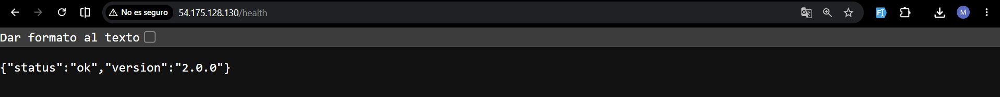

**Figura 7.** Endpoint de salud de produccion en la instancia remota con estado correcto y version 2.0.0.

### 3.2 Staging en el puerto 8080

La captura muestra la pagina principal de la aplicacion en staging. Se observa la interfaz informativa de la API con el titulo, la descripcion y la tabla de endpoints. Que la pagina cargue en el puerto 8080 confirma que el contenedor de staging esta publicado en el puerto configurado para ese entorno.

**Figura 8.** Pagina principal de staging disponible en la instancia remota por el puerto 8080.

La captura muestra el endpoint de salud de staging. La respuesta confirma que el servicio de pruebas esta activo y que corresponde a la version 2.0.0. En la captura el navegador tradujo automaticamente los nombres de las claves, pero la respuesta real del servicio mantiene el estado correcto y la version desplegada.

**Figura 9.** Endpoint de salud de staging en la instancia remota con estado correcto y version 2.0.0.

## 4. Evidencia del escaneo de vulnerabilidades

La captura muestra el trabajo de construccion y publicacion con el paso de escaneo de vulnerabilidades visible en la lista de tareas. El escaneo se ejecuta sobre la imagen identificada con el commit, revisa vulnerabilidades de sistema operativo y de librerias y se concentra en los niveles critico y alto. La configuracion deja el resultado en el registro del workflow sin detener el despliegue, para que el equipo pueda revisarlo y corregir lo necesario antes de promover la imagen.

**Figura 10.** Trabajo de construccion y publicacion con el paso de escaneo de vulnerabilidades.

## 5. Rollback a una version anterior

El rollback consiste en volver a ejecutar una imagen que ya fue publicada y que corresponde a un commit anterior. Como cada imagen se etiqueta con el identificador del commit, no es necesario reconstruir el codigo: basta con descargar la etiqueta anterior y volver a crear el contenedor con esa imagen. En la demostracion se uso el commit a0d1c6d, que corresponde a una version estable anterior.

### 5.1 Conexion al servidor

La captura muestra la conexion SSH a la instancia remota. Se observa el comando de conexion con la llave privada y la sesion abierta en el servidor. Esta es la puerta de entrada para ejecutar los comandos de rollback directamente en la instancia.

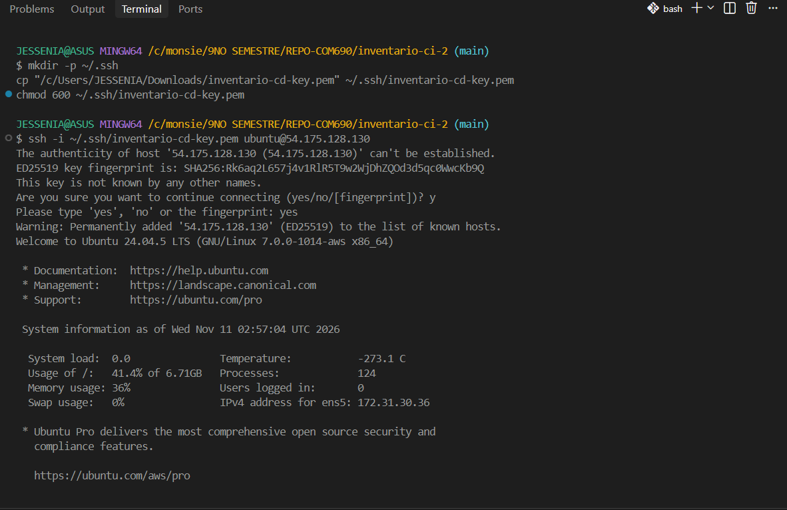

**Figura 11.** Conexion SSH a la instancia remota con la llave privada.

### 5.2 Descarga de la imagen anterior y conflicto

La captura muestra la descarga de la imagen del commit anterior y el primer intento de crear el contenedor. El intento falla porque el nombre inventario ya esta en uso. El mensaje de error es claro: detener un contenedor no lo elimina, por lo que el nombre sigue ocupado. Esta captura documenta un error real y su causa.

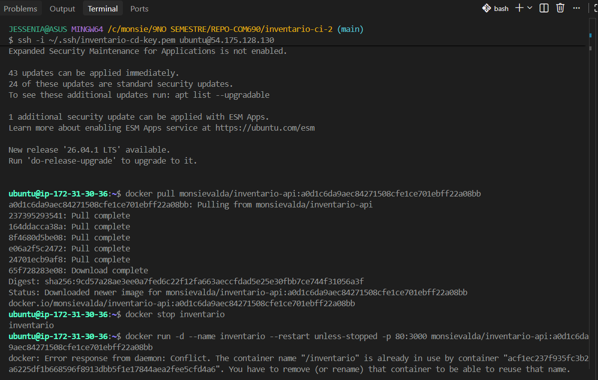

**Figura 12.** Descarga de la imagen anterior y conflicto de nombre al crear el contenedor.

### 5.3 Reemplazo del contenedor

La captura muestra la solucion. Despues de detener el contenedor se elimina el contenedor anterior y luego se crea uno nuevo con la imagen del commit anterior. Al final se consulta el estado del contenedor y se verifica que la aplicacion responde. Con esto el servicio queda funcionando con la version anterior.

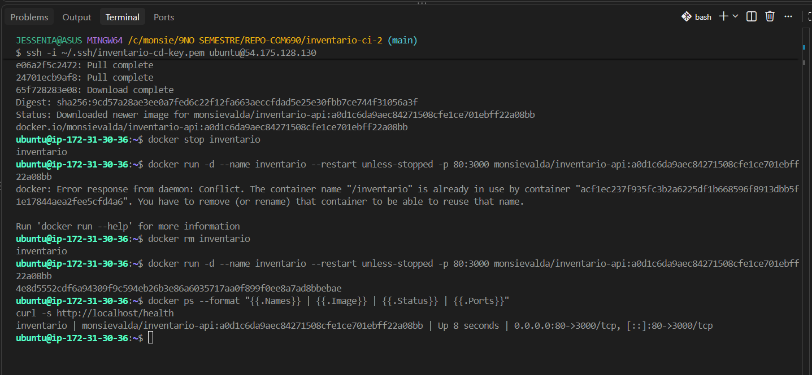

**Figura 13.** Eliminacion del contenedor anterior y creacion de uno nuevo con la imagen del commit a0d1c6d.

### 5.4 Restauracion de la version mas reciente

La captura muestra la restauracion. Una vez comprobado el rollback, se descarga la etiqueta latest, se detiene y elimina el contenedor de la version anterior y se crea nuevamente el contenedor con la version mas reciente. La verificacion final confirma que el servicio volvio a la version 2.0.0. Este paso demuestra que el rollback es reversible.

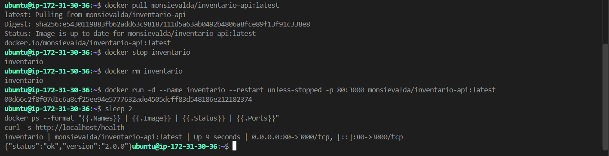

**Figura 14.** Restauracion del contenedor con la etiqueta latest y verificacion final del servicio.

## 6. Reflexion sobre las ventajas de contenedores y despliegue continuo

### 6.1 Ventajas de los contenedores

Usar contenedores en un proyecto real aporta una ventaja inmediata: la aplicacion se ejecuta igual en el equipo de desarrollo, en el servidor de pruebas y en produccion. La imagen incluye las dependencias y la version de ejecucion necesarias, por lo que se reducen los problemas de configuracion entre ambientes. Ademas, el build multi-stage permite publicar una imagen mas pequena y con menos superficie de ataque.

### 6.2 Ventajas del despliegue continuo

El despliegue continuo agrega velocidad y trazabilidad. Cada cambio aprobado se convierte en una imagen identificada por su commit, se prueba, se escanea y se despliega de forma automatica. Esto reduce los errores manuales y permite saber exactamente que version esta activa en cada entorno. Cuando algo falla, el health check evita que una version defectuosa reemplace a una version que estaba funcionando, y el etiquetado por commit permite volver atras con un procedimiento claro.

### 6.3 Impacto en un proyecto real

En un proyecto real, la combinacion de contenedores y despliegue continuo tambien mejora la colaboracion. El equipo puede revisar el resultado de cada ejecucion en la pestana Acciones, comparar versiones, detectar problemas de seguridad con el escaneo y separar los cambios de prueba de los cambios de produccion. El pipeline se convierte asi en una parte mas del proyecto y no en una tarea manual que depende de una sola persona.

## 7. Configuracion detallada de la practica individual: entornos, staging y Docker Hub

La captura muestra la creacion del entorno de staging. Este entorno agrupa los secretos y las variables que se usan para el despliegue de pruebas.

**Figura 7.1.** Creacion del entorno de staging.

La captura muestra el secreto con la direccion del servidor para staging. El valor se guarda dentro del entorno y no en el repositorio.

**Figura 7.2.** Secreto SSH_HOST del entorno de staging.

La captura muestra el secreto con el usuario SSH para staging. Este valor completa los datos de conexion del entorno de pruebas.

**Figura 7.3.** Secreto SSH_USER del entorno de staging.

La captura muestra el secreto con la llave privada para staging. La llave se guarda cifrada y se usa para la conexion SSH del entorno.

**Figura 7.4.** Secreto SSH_PRIVATE_KEY del entorno de staging.

La captura muestra la variable con el puerto de despliegue de staging. El valor 8080 es el puerto publico que usa la aplicacion de pruebas.

**Figura 7.5.** Variable DEPLOY_PORT del entorno de staging.

La captura muestra la variable con el nombre del contenedor de staging. El valor inventario-staging diferencia el contenedor de pruebas del contenedor de produccion.

**Figura 7.6.** Variable CONTAINER_NAME del entorno de staging.

La captura muestra el resumen del entorno de staging. Se observan los tres secretos y las dos variables que usa el despliegue de pruebas.

**Figura 7.7.** Entorno de staging con sus secretos y variables.

La captura muestra la creacion del entorno de produccion. Este entorno agrupa los secretos y las variables que se usan para el despliegue real.

**Figura 7.8.** Creacion del entorno de produccion.

La captura muestra el secreto con la direccion del servidor para produccion. El valor se guarda dentro del entorno de produccion.

**Figura 7.9.** Secreto SSH_HOST del entorno de produccion.

La captura muestra el secreto con el usuario SSH para produccion. Este valor completa los datos de conexion del entorno real.

**Figura 7.10.** Secreto SSH_USER del entorno de produccion.

La captura muestra la variable con el puerto de despliegue de produccion. El valor 80 es el puerto publico que usa la aplicacion real.

**Figura 7.11.** Variable DEPLOY_PORT del entorno de produccion.

La captura muestra la variable con el nombre del contenedor de produccion. El valor inventario identifica el contenedor del servicio real.

**Figura 7.12.** Variable CONTAINER_NAME del entorno de produccion.

La captura muestra el resumen del entorno de produccion. Se observan los tres secretos y las dos variables que usa el despliegue real.

**Figura 7.13.** Entorno de produccion con sus secretos y variables.

La captura muestra la lista de entornos configurados. Se observan los entornos de produccion y staging, cada uno con sus secretos y variables. Esta separacion permite que el mismo workflow despliegue en destinos distintos segun la rama.

**Figura 7.14.** Entornos de produccion y staging con sus secretos y variables.

La captura muestra la edicion de la regla de entrada del grupo de seguridad para permitir el acceso al puerto 8080. Sin esta regla la aplicacion de staging no seria accesible desde el navegador.

**Figura 7.15.** Edicion de la regla de entrada para el puerto 8080.

La captura muestra la regla aplicada en el grupo de seguridad. Se observan las reglas de los puertos 22, 80 y 8080, que permiten la administracion, el acceso a produccion y el acceso a staging.

**Figura 7.16.** Grupo de seguridad con las reglas de los puertos 22, 80 y 8080.

La captura muestra los disparadores del workflow final. Se observa que el workflow se ejecuta con push a main y a staging.

**Figura 7.17.** Workflow final con disparadores en main y staging.

La captura muestra las etiquetas por rama y el paso de escaneo con Trivy. Se observa como la etiqueta latest se usa en main y la etiqueta staging se usa en staging.

**Figura 7.18.** Etiquetas por rama y paso de escaneo con Trivy.

La captura muestra el inicio del trabajo de despliegue de produccion con el entorno de produccion. Se observa la condicion que activa este trabajo solo en la rama principal.

**Figura 7.19.** Inicio del trabajo de despliegue de produccion con el entorno de produccion.

La captura muestra el script de despliegue de produccion. Se observan la descarga de la imagen, la creacion del contenedor temporal y el health check antes de reemplazar el contenedor activo.

**Figura 7.20.** Script de despliegue de produccion con puerto temporal y health check.

La captura muestra el final del script de produccion. Se observa el reemplazo del contenedor y el manejo del fallo del health check con la salida de error.

**Figura 7.21.** Reemplazo del contenedor de produccion y manejo del fallo del health check.

La captura muestra el trabajo de despliegue de staging con el entorno de staging. Se observa la condicion que activa este trabajo solo en la rama de staging.

**Figura 7.22.** Trabajo de despliegue de staging con el entorno de staging.

La captura muestra el commit y el push del workflow final. Con este paso el workflow con entornos y Trivy queda versionado en el repositorio.

**Figura 7.23.** Commit y push del workflow final con entornos y Trivy.

La captura muestra las etiquetas publicadas en Docker Hub. Se observan la etiqueta de staging, la etiqueta latest y las etiquetas con el identificador de cada commit. Esta lista permite elegir una version exacta para un rollback.

**Figura 7.24.** Etiquetas de staging, latest y commits publicadas en Docker Hub.

La captura muestra mas etiquetas de commits anteriores. Se observan los identificadores de las versiones usadas durante las pruebas y el despliegue.

**Figura 7.25.** Etiquetas de commits anteriores en Docker Hub.

La captura muestra las etiquetas de los commits usados para el rollback y para las pruebas de version. Esta lista es la que permite identificar la imagen exacta que se quiere recuperar.

**Figura 7.26.** Etiquetas de los commits usados en las pruebas y en el rollback.

# Parte II: Ejercicios del laboratorio

Los ejercicios se presentan en orden y separados de la practica individual. Cada uno conserva sus capturas como evidencia del proceso seguido antes de llegar al pipeline final.

## Ejercicio 3.1: Dockerfile multi-stage y prueba local

El Dockerfile se construyo con dos etapas. La primera prepara la aplicacion y las dependencias de produccion; la segunda copia solamente lo necesario para ejecutar el servicio. La captura muestra la estructura completa del archivo y la separacion entre la etapa de construccion y la etapa de ejecucion.

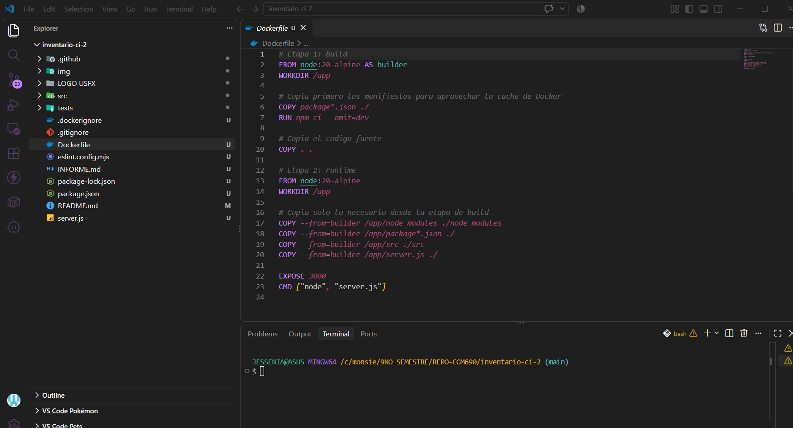

**Figura 3.1.1.** Dockerfile con la etapa de construccion y la etapa final de ejecucion.

El archivo .dockerignore excluye del contexto de build las dependencias instaladas, los archivos de Git, las pruebas, las imagenes y los archivos del informe. Esto evita enviar al daemon de Docker archivos que no se necesitan para construir la imagen.

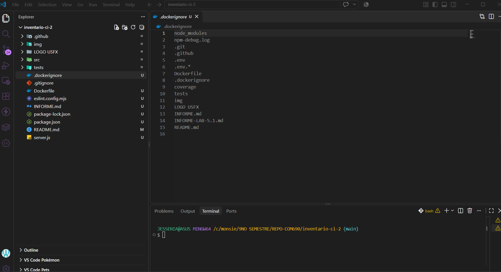

**Figura 3.1.2.** Contenido del archivo .dockerignore.

La captura muestra la construccion local de la imagen. Docker ejecuta las dos etapas y la imagen final se crea correctamente. Esta prueba se hizo antes de publicar la imagen para confirmar que el Dockerfile funcionaba en el equipo local.

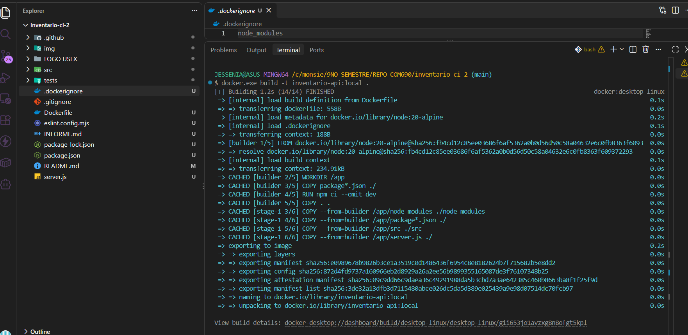

**Figura 3.1.3.** Construccion local de la imagen con las dos etapas del Dockerfile.

La captura muestra la creacion del contenedor local a partir de la imagen construida. El contenedor se inicia en el puerto 3000 y queda disponible para la prueba de salud.

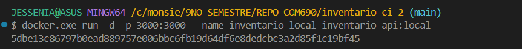

**Figura 3.1.4.** Creacion del contenedor local con la imagen construida.

La captura muestra el contenedor en ejecucion y la respuesta del endpoint de salud. El contenedor respondio correctamente, lo que confirmo que la aplicacion estaba lista para ser publicada.

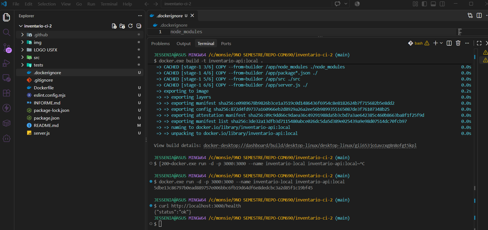

**Figura 3.1.5.** Contenedor local en ejecucion y respuesta correcta del endpoint de salud.

La captura muestra el endpoint de salud anterior en el codigo y la misma prueba local ejecutada desde la terminal. Se observa la respuesta inicial del servicio, que servira de comparacion para el cambio de version posterior.

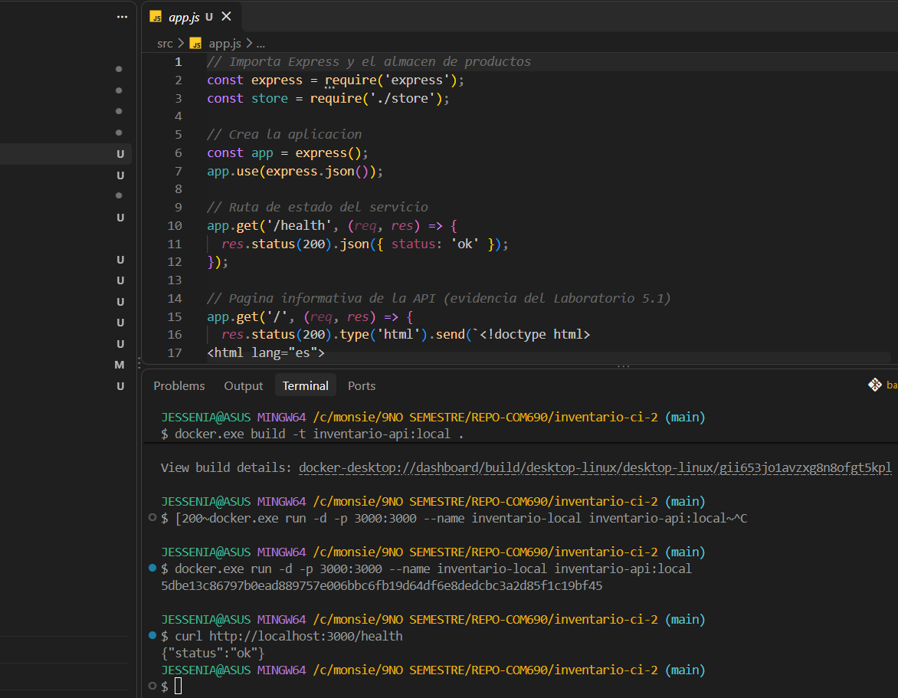

**Figura 3.1.6.** Codigo del endpoint de salud inicial y prueba local del contenedor.

La captura muestra la detencion y eliminacion del contenedor de prueba. Esta limpieza deja el equipo local sin contenedores innecesarios y confirma que el ciclo de prueba local se completo.

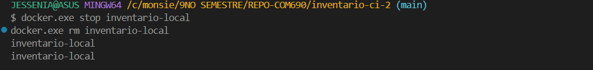

**Figura 3.1.7.** Detencion y eliminacion del contenedor local.

La captura muestra el commit y el push del Dockerfile y del archivo .dockerignore. Con este paso los archivos quedan versionados en el repositorio y disponibles para el workflow.

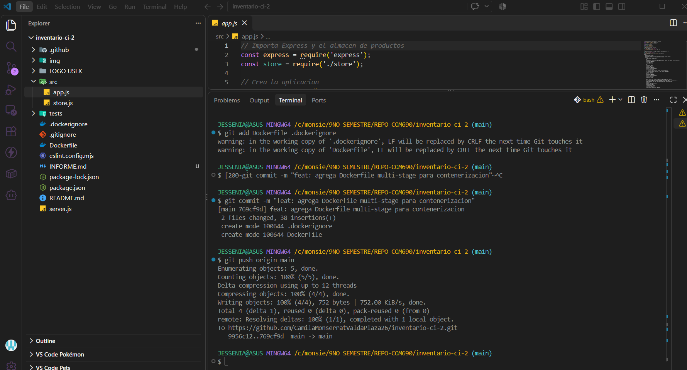

**Figura 3.1.8.** Commit y push del Dockerfile y del archivo .dockerignore.

## Ejercicio 3.2: Configuracion de secretos y variables

La captura muestra la creacion del secreto con el usuario de Docker Hub. Este valor se usa para iniciar sesion y para componer el nombre de la imagen que se publica.

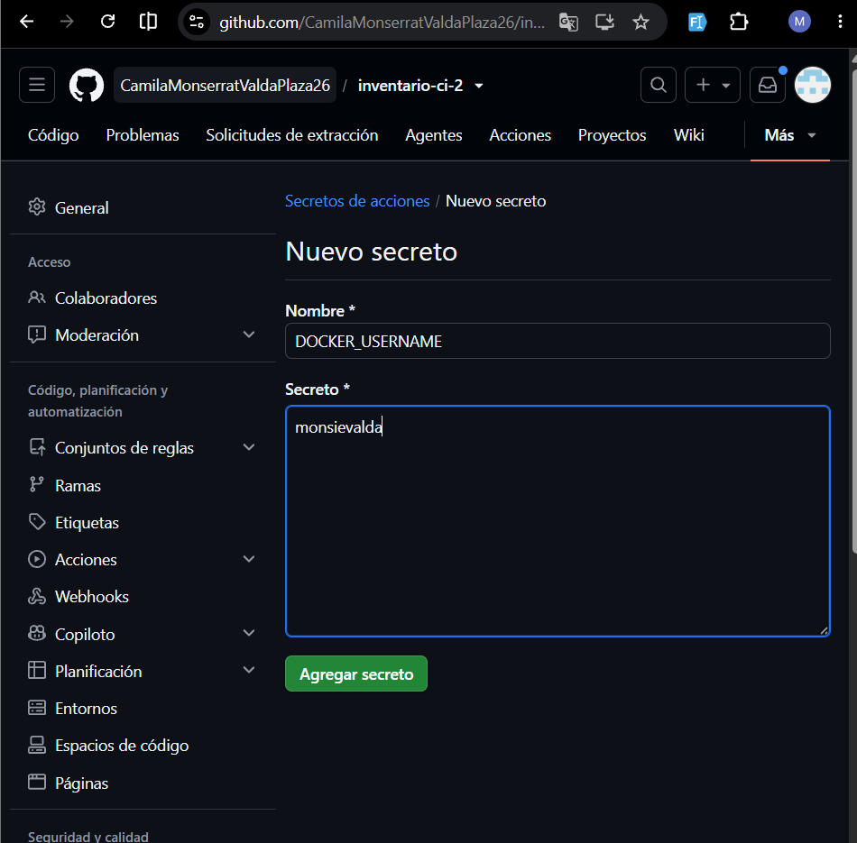

**Figura 3.2.1.** Creacion del secreto DOCKER_USERNAME.

La captura muestra la creacion del secreto con el token de Docker Hub. El token se usa en lugar de la contrasena principal para reducir el riesgo de exposicion de la cuenta.

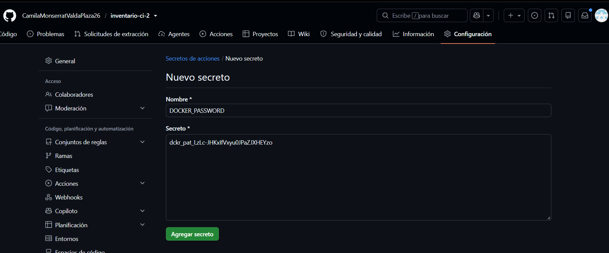

**Figura 3.2.2.** Creacion del secreto DOCKER_PASSWORD.

La captura muestra la creacion del secreto con la direccion publica de la instancia. Este valor lo usa la accion de conexion SSH para llegar al servidor remoto.

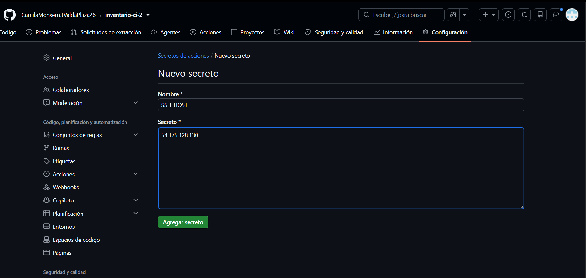

**Figura 3.2.3.** Creacion del secreto SSH_HOST.

La captura muestra la creacion del secreto con el usuario SSH de la instancia. Este valor completa los datos de conexion al servidor.

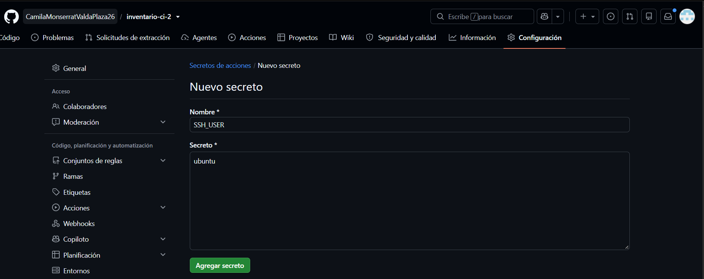

**Figura 3.2.4.** Creacion del secreto SSH_USER.

La captura muestra la creacion del secreto con el contenido de la llave privada. La llave se guarda cifrada y el workflow la usa para autenticarse sin exponerla en el registro.

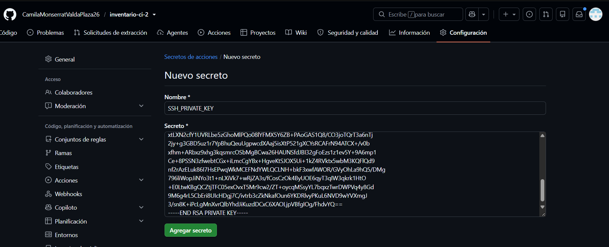

**Figura 3.2.5.** Creacion del secreto SSH_PRIVATE_KEY.

La captura muestra el formulario de creacion de la variable de repositorio para el nombre de la imagen. La variable no es un dato sensible, por eso se guarda como variable y no como secreto.

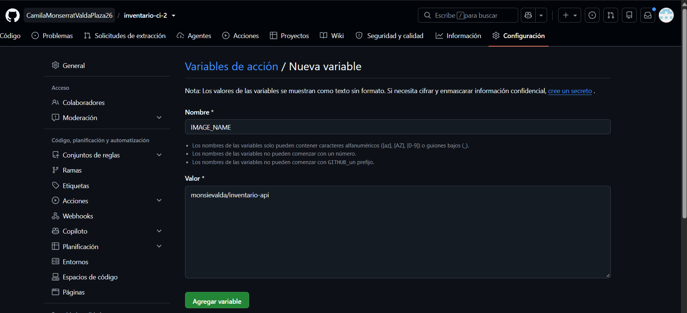

**Figura 3.2.6.** Creacion de la variable IMAGE_NAME.

La captura muestra la variable registrada en la pestana Variables. Se observa el nombre y el valor con el usuario de Docker Hub y el nombre de la imagen.

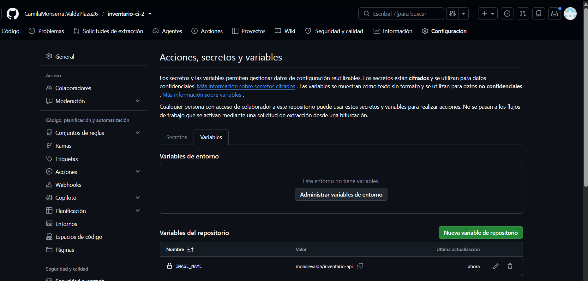

**Figura 3.2.7.** Variable IMAGE_NAME registrada en el repositorio.

La captura muestra la lista de secretos del repositorio. Se observan las credenciales de Docker Hub y los datos de conexion al servidor remoto. Estos valores se guardan cifrados y el workflow los consume sin mostrarlos en el registro.

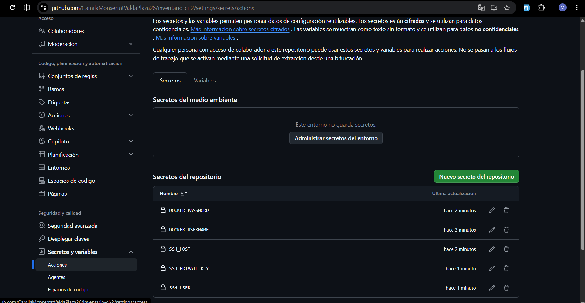

**Figura 3.2.8.** Lista de secretos configurados en el repositorio.

La captura muestra la creacion de un token inicial en Docker Hub. Este token se uso en la primera prueba de publicacion de la imagen.

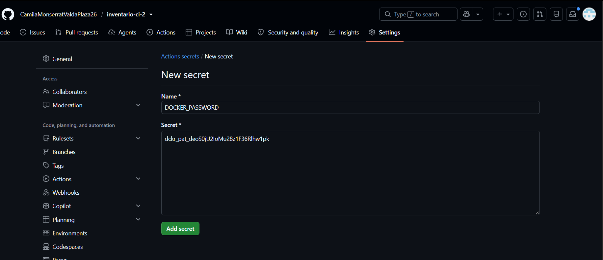

**Figura 3.2.9.** Creacion del token inicial de Docker Hub.

La captura documenta el problema del token inicial. El token tenia permisos de solo lectura, por lo que la publicacion de la imagen fallo con un error de permisos insuficientes. La captura permite ver el mensaje y entender que el problema estaba en el permiso del token.

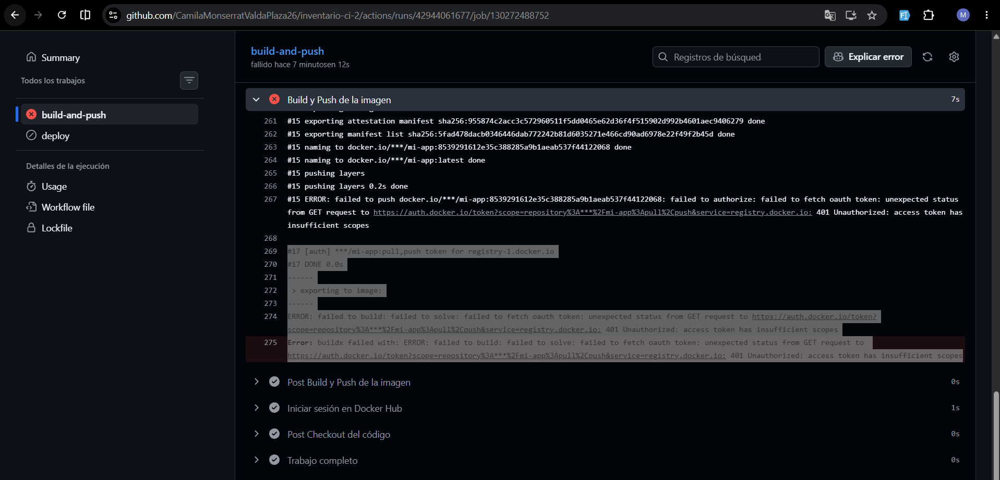

**Figura 3.2.10.** Error de publicacion por permisos insuficientes del token.

La captura muestra la creacion de un token nuevo con permiso de lectura y escritura. Este cambio fue necesario para que la imagen se pudiera publicar correctamente.

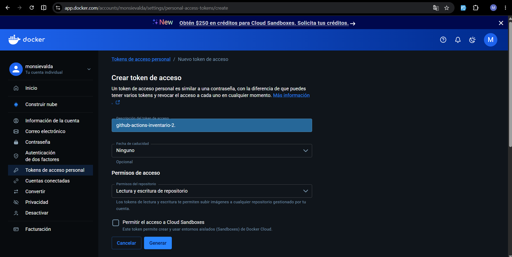

**Figura 3.2.11.** Creacion del token con permiso de lectura y escritura.

La captura muestra la actualizacion del secreto con el token nuevo. Despues de este cambio la publicacion de la imagen se completo sin errores.

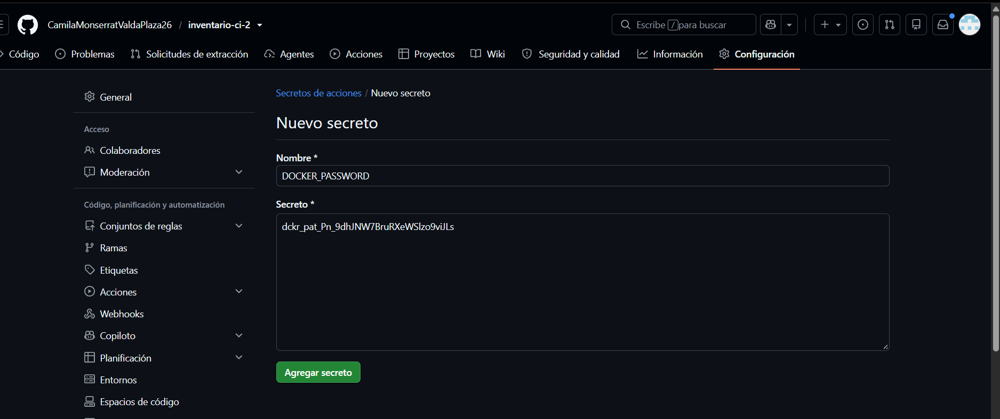

**Figura 3.2.12.** Actualizacion del secreto DOCKER_PASSWORD con el token nuevo.

La captura muestra la lista final de secretos del repositorio. Se observan los cinco secretos necesarios para construir, publicar y desplegar la imagen.

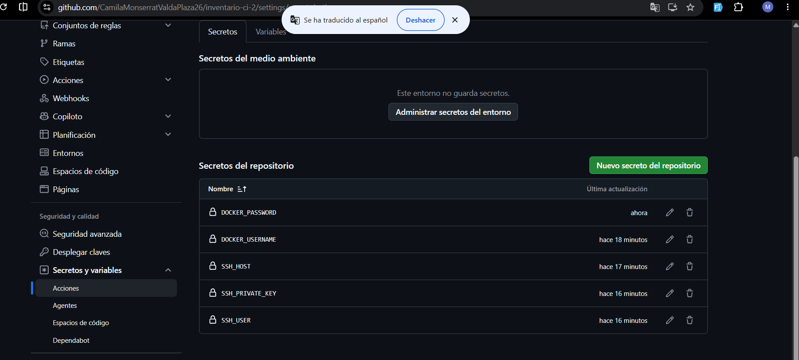

**Figura 3.2.13.** Lista final de secretos del repositorio.

## Ejercicio 3.3: Workflow de build, push y deploy

La captura muestra el inicio del workflow de CD. Se observan el nombre del workflow, los disparadores y el comienzo del trabajo de construccion y publicacion.

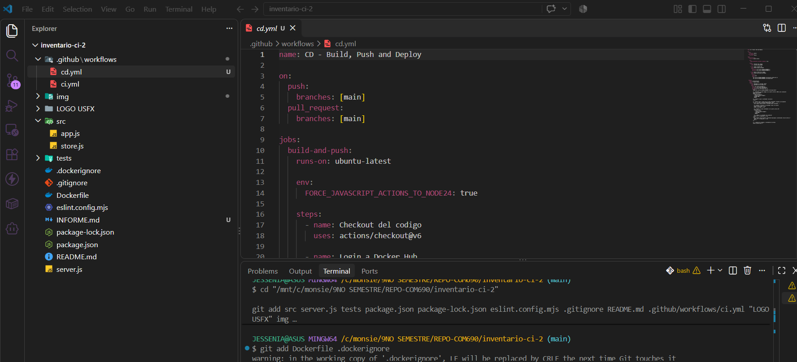

**Figura 3.3.1.** Inicio del archivo cd.yml con los disparadores y el trabajo de construccion.

La captura muestra la configuracion del login y del push a Docker Hub. Se observan las etiquetas con el identificador del commit y con la etiqueta latest.

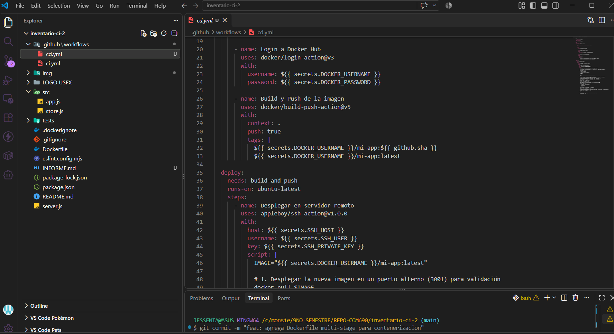

**Figura 3.3.2.** Configuracion del login y del push de la imagen a Docker Hub.

La captura muestra el script de despliegue. Se observan la descarga de la imagen, la creacion del contenedor temporal, el health check y el reemplazo del contenedor activo.

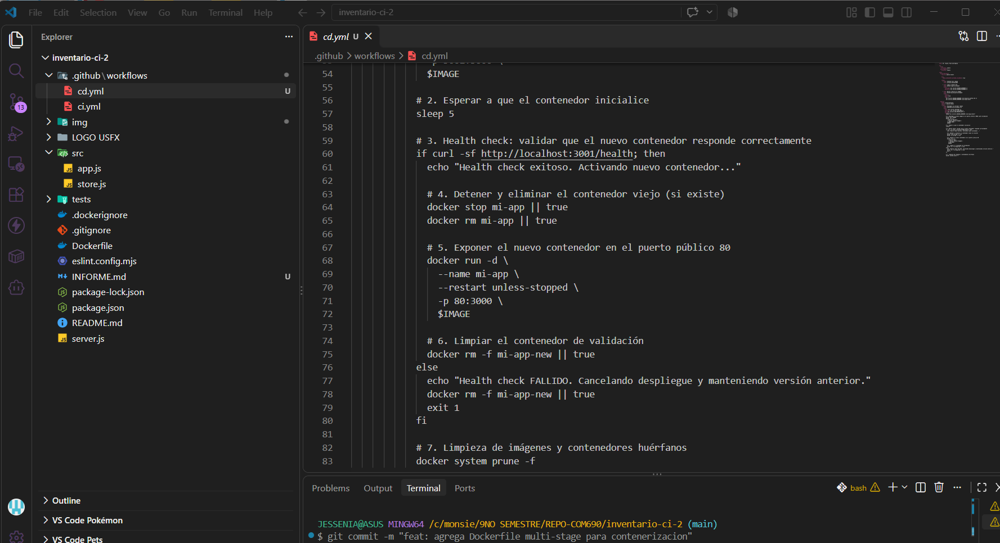

**Figura 3.3.3.** Script de despliegue con health check y reemplazo del contenedor.

La captura muestra el commit y el push del workflow. Con este paso el archivo queda versionado y GitHub Actions lo toma en la siguiente ejecucion.

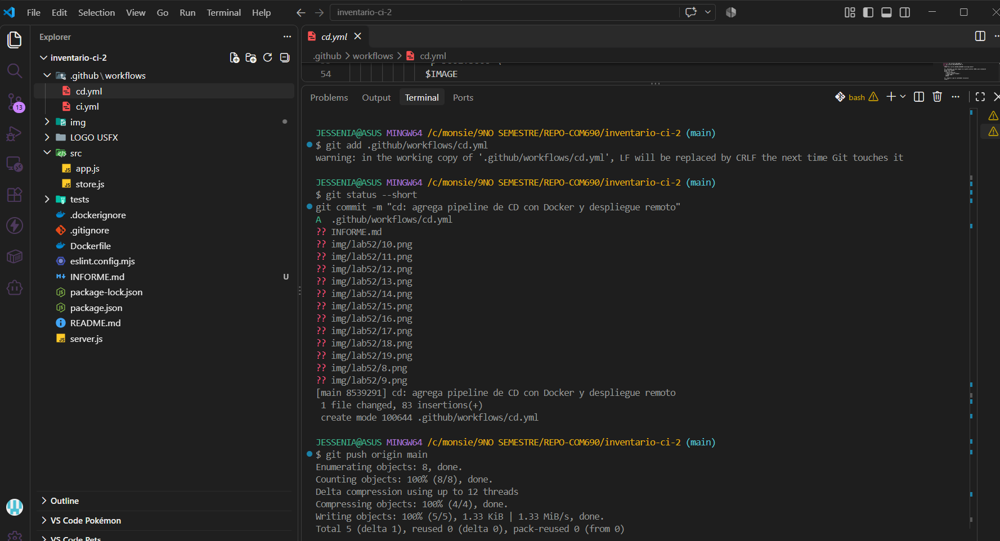

**Figura 3.3.4.** Commit y push del workflow de CD.

La captura muestra el archivo del workflow con el nombre de la imagen y la configuracion de las etiquetas. Esta vista permite revisar como se compone el nombre de la imagen publicada.

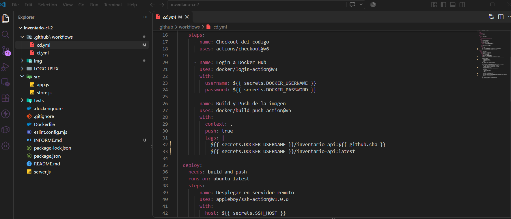

**Figura 3.3.5.** Archivo del workflow con el nombre de la imagen y las etiquetas.

La captura muestra una ejecucion del workflow de CD completada correctamente. Se observan los trabajos de construccion y despliegue en verde y la duracion de la ejecucion.

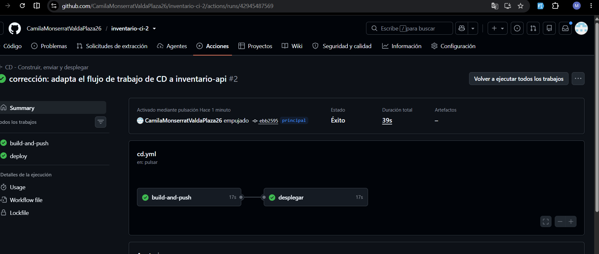

**Figura 3.3.6.** Ejecucion del workflow de CD con los trabajos de construccion y despliegue en verde.

La captura muestra una ejecucion del workflow de integracion continua completada correctamente. El trabajo de compilacion y pruebas termino en verde y genero el artefacto de cobertura.

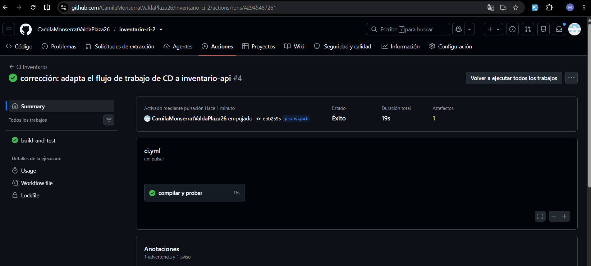

**Figura 3.3.7.** Ejecucion del workflow de integracion continua completada correctamente.

La captura muestra el detalle del trabajo de despliegue. Se observan los pasos de preparacion, la accion de conexion SSH y el despliegue en el servidor remoto.

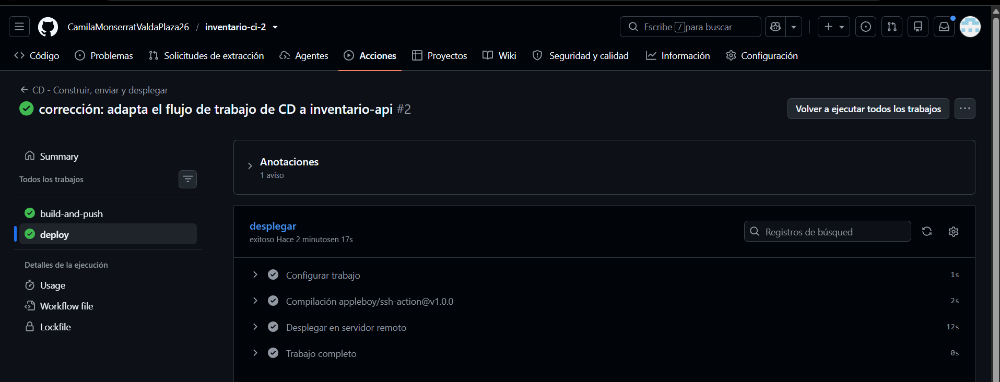

**Figura 3.3.8.** Trabajo de despliegue completado con la conexion SSH y el despliegue remoto.

La captura muestra el detalle del trabajo de construccion y publicacion. Se observan el checkout, el login, la construccion y el push de la imagen.

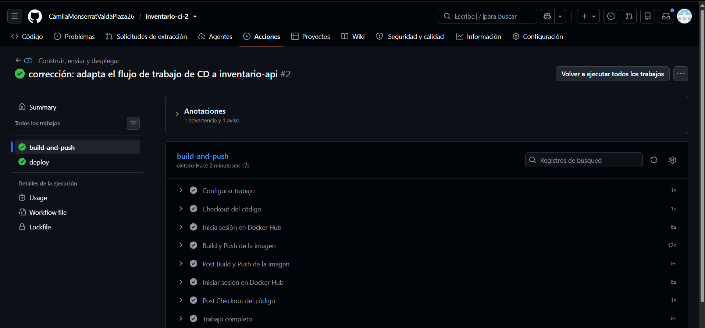

**Figura 3.3.9.** Trabajo de construccion y publicacion completado correctamente.

La captura muestra la aplicacion respondiendo desde la instancia remota con la version inicial. Esta evidencia confirma que el primer despliegue dejo el servicio disponible en el puerto publico.

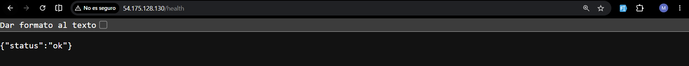

**Figura 3.3.10.** Aplicacion respondiendo desde la instancia remota con la version inicial.

La captura muestra una ejecucion del workflow de integracion continua sobre la version final del proyecto. El trabajo de compilacion y pruebas termino en verde, lo que confirma que los cambios de configuracion no rompieron las pruebas.

**Figura 3.3.11.** Workflow de integracion continua completado sobre la version final del proyecto.

La captura muestra la pestana Acciones con el listado de ejecuciones del workflow de CD. Se observan las ramas, los estados y la cantidad de ejecuciones registradas, lo que confirma que el workflow se activa con cada push.

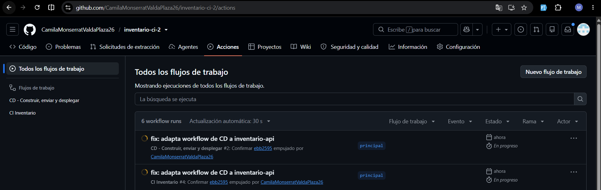

**Figura 3.3.12.** Pestana Acciones con el listado de ejecuciones del workflow de CD.

## Ejercicio 3.4: Verificacion, fallo simulado y rollback

La captura muestra el cambio en el endpoint de salud. Se agrego la version 2.0.0 a la respuesta para comprobar que el cambio realmente llegaba al servidor.

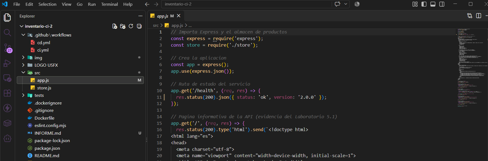

**Figura 3.4.1.** Codigo del endpoint de salud con la version 2.0.0.

La captura muestra la pestana Acciones con las ejecuciones generadas por el cambio de version. Se observan las ejecuciones del CI y del CD en curso.

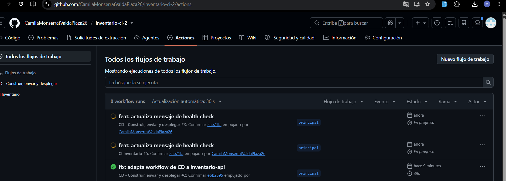

**Figura 3.4.2.** Pestana Acciones con las ejecuciones del cambio de version.

La captura muestra el commit y el push del cambio de version. El commit queda identificado y el push dispara el pipeline.

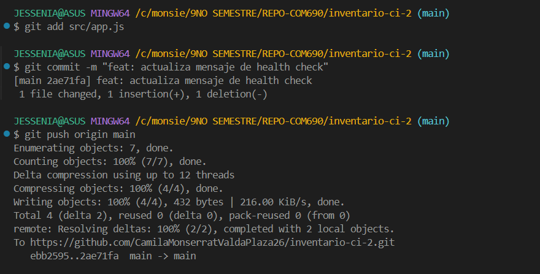

**Figura 3.4.3.** Commit y push del cambio de version.

La captura muestra la instancia remota respondiendo con la version 2.0.0. Esta evidencia confirma que el cambio de version llego al servidor.

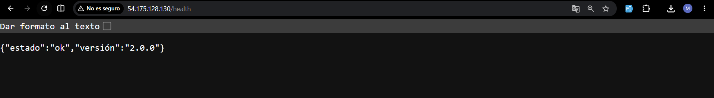

**Figura 3.4.4.** Aplicacion remota respondiendo con la version 2.0.0.

La captura muestra el fallo del CI. Al cambiar la respuesta del endpoint, la prueba existente dejo de coincidir y el workflow de integracion continua quedo en rojo. Esto demuestra que las pruebas protegen el comportamiento esperado.

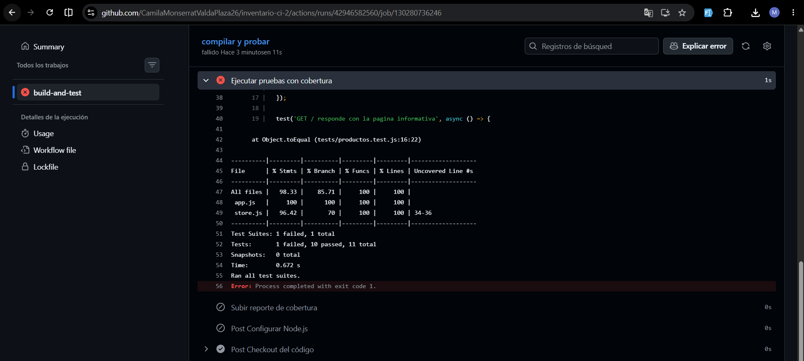

**Figura 3.4.5.** Ejecucion de pruebas fallida porque la prueba esperaba la respuesta anterior.

La captura muestra la ejecucion del CD con el cambio de version completada correctamente. El despliegue se hizo aunque el CI estuviera en rojo, lo que permite observar la diferencia entre ambos workflows.

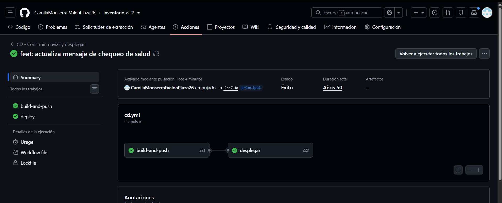

**Figura 3.4.6.** Ejecucion del CD con el cambio de version completada correctamente.

La captura muestra la pestana Acciones con el CD en verde y el CI en rojo. Esta vista resume el estado de ambos workflows despues del cambio de version.

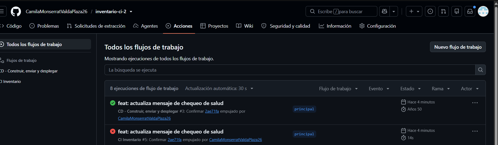

**Figura 3.4.7.** Pestana Acciones con el CD en verde y el CI en rojo.

La captura muestra el commit de la correccion de la prueba. Se actualizo la expectativa para que coincida con la version 2.0.0.

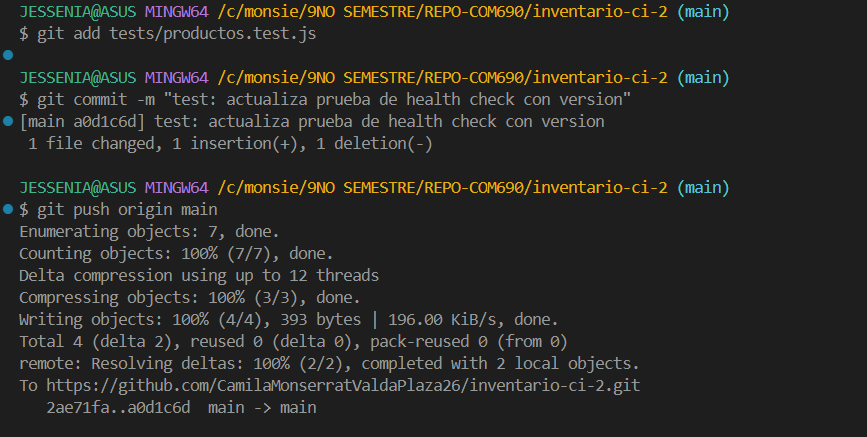

**Figura 3.4.8.** Commit y push de la correccion de la prueba.

La captura muestra las nuevas ejecuciones del CI y del CD en progreso despues de la correccion. Se observa que ambos workflows se disparan con el mismo push.

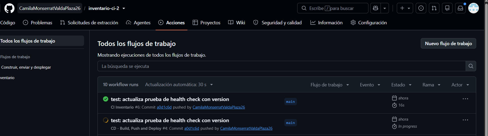

**Figura 3.4.9.** Nuevas ejecuciones del CI y del CD en progreso.

La captura muestra las nuevas ejecuciones del CI y del CD completadas correctamente. Con esto se confirma que la correccion de la prueba dejo ambos workflows en verde.

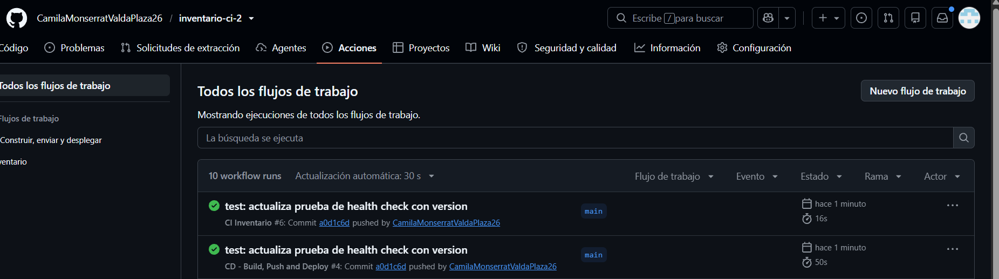

**Figura 3.4.10.** CI y CD completados correctamente despues de la correccion.

La captura muestra la prueba actualizada con la version 2.0.0. La expectativa coincide con la respuesta real del endpoint.

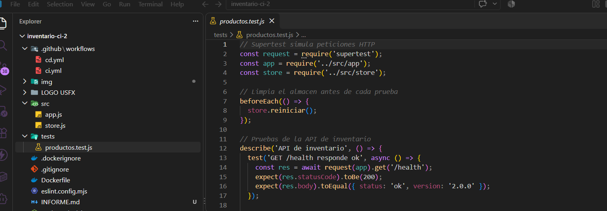

**Figura 3.4.11.** Prueba del endpoint de salud actualizada con la version 2.0.0.

La captura muestra la simulacion del fallo. Se cambio el puerto del servidor a 3001 para que la aplicacion no respondiera en el puerto esperado. El objetivo era comprobar que el pipeline detecta una version defectuosa antes de reemplazar el contenedor activo.

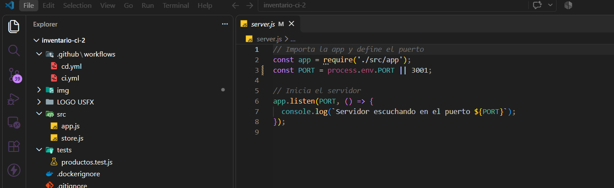

**Figura 3.4.12.** Codigo del servidor modificado para escuchar en el puerto 3001.

La captura muestra las ejecuciones del CI y del CD en cola o en progreso despues del cambio de puerto. El CI se ejecuta primero y el CD espera su turno.

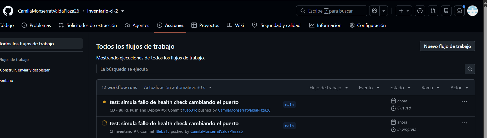

**Figura 3.4.13.** Pestana Acciones con las ejecuciones del fallo en curso.

La captura muestra el resultado del fallo. El CD aparece en rojo y el CI en verde. Esto confirma que el problema estaba en el despliegue y no en la compilacion o en las pruebas.

**Figura 3.4.14.** Pestana Acciones con el CD fallido y el CI exitoso.

La captura muestra el detalle del trabajo de despliegue fallido. El trabajo de construccion se completo, pero el despliegue fallo porque el health check no obtuvo respuesta.

**Figura 3.4.15.** Trabajo de despliegue fallido por el health check.

La captura muestra que la version anterior siguio funcionando despues del fallo. La aplicacion continuo respondiendo con la version 2.0.0 en el puerto de produccion. Esta es la prueba de que el health check protegio el servicio y de que el contenedor anterior no fue reemplazado.

**Figura 3.4.16.** Servicio de produccion respondiendo con la version anterior despues del fallo del despliegue.

## Comandos utilizados

Esta lista reune los comandos que se ejecutaron durante el laboratorio y su proposito en una linea.

| Comando | Para que se uso |
|---|---|
| git add . | Prepara todos los cambios del proyecto para el commit. |
| git commit -m mensaje | Guarda los cambios en el historial local con una descripcion. |
| git push origin main | Sube la rama principal al repositorio remoto y dispara el pipeline. |
| git checkout -b staging | Crea la rama de pruebas. |
| git push origin staging | Sube la rama de pruebas y activa el despliegue de staging. |
| npm install | Instala las dependencias del proyecto. |
| npm test | Ejecuta las pruebas automatizadas de la API. |
| docker build -t inventario-api . | Construye la imagen local con el Dockerfile multi-stage. |
| docker run -d --name inventario -p 3000:3000 inventario-api | Crea el contenedor local de prueba en el puerto 3000. |
| curl http://localhost:3000/health | Consulta el endpoint de salud en el equipo local. |
| docker ps | Lista los contenedores en ejecucion. |
| docker stop inventario | Detiene el contenedor sin eliminarlo. |
| docker rm inventario | Elimina el contenedor detenido. |
| ssh -i ~/.ssh/inventario-cd-key.pem ubuntu@54.175.128.130 | Abre una sesion en la instancia remota con la llave privada. |
| docker pull monsievalda/inventario-api:latest | Descarga la imagen mas reciente publicada en Docker Hub. |
| docker pull monsievalda/inventario-api:SHA | Descarga una version exacta para el rollback. |
| docker run -d --name inventario --restart unless-stopped -p 80:3000 monsievalda/inventario-api:latest | Crea el contenedor de produccion en el puerto 80. |
| curl http://54.175.128.130/health | Verifica el servicio de produccion. |
| curl http://54.175.128.130:8080/health | Verifica el servicio de staging. |

El login en Docker Hub, el push de la imagen y el despliegue remoto tambien se ejecutan con comandos, pero en este laboratorio los realiza el workflow de GitHub Actions de forma automatica, por eso no se escriben a mano.

## Referencias

- Documentacion de Docker: <https://docs.docker.com/>
- Documentacion de GitHub Actions: <https://docs.github.com/actions>
- Docker Hub Access Tokens: <https://docs.docker.com/security/for-developers/access-tokens/>
- Trivy: <https://github.com/aquasecurity/trivy-action>
